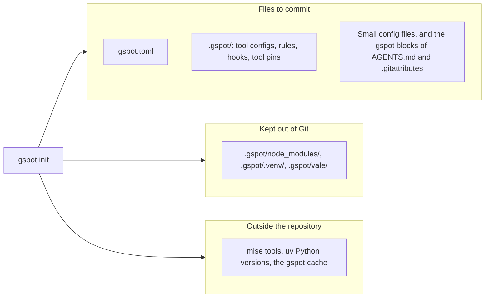

gspot writes its files from the settings in `gspot.toml`. To change a generated file, change the setting with `gspot set`,
`gspot add`, or `gspot ignore`, which rewrite the files. After you edit `gspot.toml` by hand, run `gspot install`.



## Files to commit

| Path                                                                                 | Holds                                                                    |
| ------------------------------------------------------------------------------------ | ------------------------------------------------------------------------ |
| `gspot.toml`                                                                         | Your settings.                                                           |
| `.gspot/configurations/<configuration>/`                                             | The config files of the tools of one configuration.                      |
| `.gspot/rules/`                                                                      | The rules for coding agents.                                             |
| `.gspot/hooks/`                                                                      | The Git hooks.                                                           |
| `package.json`, `pyproject.toml`, and `mise.toml` in `.gspot/`, with their lockfiles | The tools and their pinned versions.                                     |
| Small files in your folders, such as `eslint.config.mjs` and `ruff.toml`             | They load the real config from `.gspot/`, so editors use the same rules. |
| `.editorconfig` and `.prettierignore`                                                | Editor settings, and the files that Prettier skips.                      |
| `.github/workflows/gspot.yml` or `.gitlab/ci/gspot.yml`                              | The CI job, when [CI](/use/ci/) is on.                                   |
| The gspot blocks in `AGENTS.md` and `.gitattributes`                                 | The text between the gspot markers. The rest of each file stays yours.   |
| Keys in your files, such as `install.security.scanner` in `bunfig.toml`              | Install options. The other keys stay yours.                              |

The gspot block of `.gitattributes` marks the generated files `linguist-generated`, except the hooks and the CI workflow,
which stay open in review.

## Do not edit generated files

`gspot install` overwrites each generated file, and with it any local edit or merge conflict marker, so make the change in
`gspot.toml` first.

## Installed tools

`gspot install` installs the tools, and a `.gitignore` in `.gspot/` and in `.gspot-copies/` keeps these folders out of Git.

| Path                   | Holds                                                                           | To clear it                                                                                   |
| ---------------------- | ------------------------------------------------------------------------------- | --------------------------------------------------------------------------------------------- |
| `.gspot/node_modules/` | The npm tools.                                                                  | Delete it, then run `gspot install`.                                                          |
| `.gspot/.venv/`        | The Python tools. It is separate from the `.venv/` of your project.             | Delete it, then run `gspot install`.                                                          |
| `.gspot/vale/`         | The Vale packages.                                                              | Delete it, then run `gspot install`.                                                          |
| `.gspot-copies/`       | Temporary copies of your files for `gspot scan` and for checks of staged files. | gspot deletes each copy after its run. If a copy stays behind, delete it while no check runs. |

Do not delete the tool pins, their lockfiles, or the other files in `.gspot/`.

## Caches outside the repository

| What                         | Where                                                                                                                          |
| ---------------------------- | ------------------------------------------------------------------------------------------------------------------------------ |
| mise tools                   | The mise data folder. Other repositories share them.                                                                           |
| Python versions and packages | The uv data and cache folders.                                                                                                 |
| The gspot cache              | `gspot/` in your cache folder. It holds code parsers that some checks download during `gspot install`, and Swift build output. |

The cache folder is `$XDG_CACHE_HOME` when you set it. Otherwise, it is `%LOCALAPPDATA%` on Windows, `~/Library/Caches` on
macOS, and `~/.cache` on other systems.

## Free disk space

Preview the mise versions that no project uses, then remove them:

```shell
mise prune --dry-run
mise prune
```

Other repositories can still need a version, so read the preview first.

`uv cache prune` removes cached packages that nothing uses. It keeps the Python versions. To remove one, run
`uv python uninstall <version>`.

You can delete `gspot/` in your cache folder. `gspot install` downloads the code parsers again, and the next Swift check
builds again.

## Dependency bots

gspot updates the tool versions in `.gspot/` when you upgrade gspot. Set your dependency bot to skip that folder. For
Renovate, set `"ignorePaths": [".gspot/**"]`.
