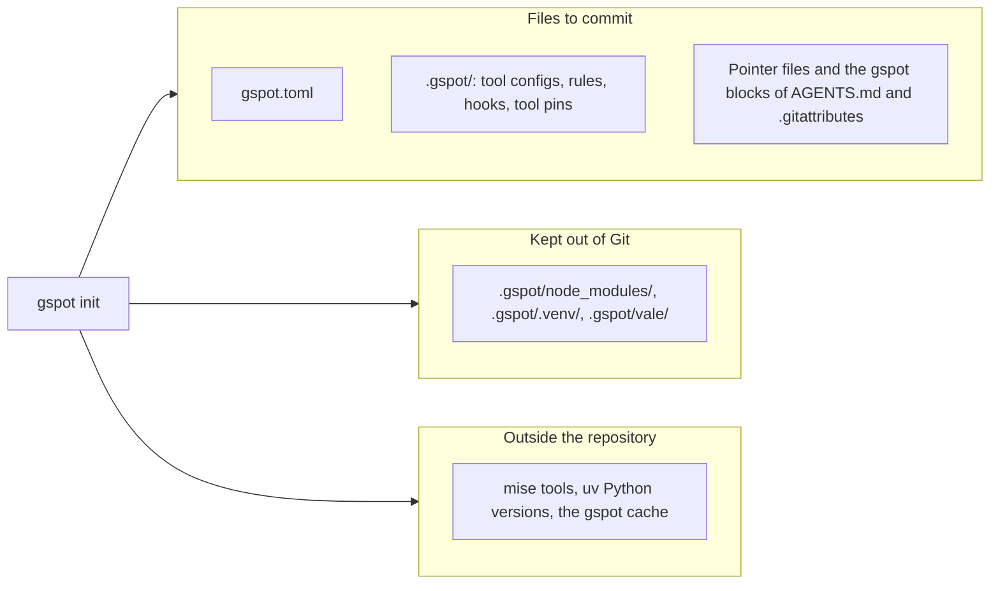

gspot writes its files from `gspot.toml`. To change one, change `gspot.toml` and run `gspot install`.



## Files to commit

| Path                                                                                    | Holds                                                                        |
| --------------------------------------------------------------------------------------- | ---------------------------------------------------------------------------- |
| `gspot.toml`                                                                            | Your settings.                                                               |
| `gspot.baseline.json`                                                                   | The counts of a [baseline](/use/baseline/). `gspot install` leaves it alone. |
| `.gspot/configurations/`                                                                | The config files of the tools.                                               |
| `.gspot/rules/`                                                                         | The rules for coding agents.                                                 |
| `.gspot/hooks/`                                                                         | The Git hooks.                                                               |
| `.gspot/package.json`, `.gspot/pyproject.toml`, `.gspot/mise.toml`, and their lockfiles | The pinned tools.                                                            |
| Pointer files, such as `eslint.config.mjs` and `ruff.toml`                              | Files that lead a tool or an editor to its config file in `.gspot/`.         |
| `.editorconfig` and `.prettierignore`                                                   | Editor settings, and the files that Prettier skips.                          |
| `.github/workflows/gspot.yml` or `.gitlab/ci/gspot.yml`                                 | The CI job, when [CI](/use/ci/) is on.                                       |
| The gspot blocks in `AGENTS.md` and `.gitattributes`                                    | The text between the gspot markers. The rest of each file stays yours.       |
| Keys in your files, such as `install.security.scanner` in `bunfig.toml`                 | Install options. The other keys stay yours.                                  |

The gspot block of `.gitattributes` marks each generated file outside `.gspot/` with `linguist-generated`. A new clone
runs `gspot install` to install its tools.

## Do not edit generated files

`gspot install` replaces each generated file, including local edits and merge markers. Move the change into
`gspot.toml` first. A file outside `.gspot/` that starts with the gspot header stays yours unless gspot writes that
path. `gspot install` names each file that it removes.

## Installed tools

These folders stay out of Git. `.gspot/.gitignore` lists the first three.

| Path                   | Holds                                                               | To clear it                                                                            |
| ---------------------- | ------------------------------------------------------------------- | -------------------------------------------------------------------------------------- |
| `.gspot/node_modules/` | The npm tools.                                                      | Delete it, then run `gspot install`.                                                   |
| `.gspot/.venv/`        | The Python tools. It is separate from the `.venv/` of your project. | Delete it, then run `gspot install`.                                                   |
| `.gspot/vale/`         | The Vale packages.                                                  | Delete it, then run `gspot install`.                                                   |
| `.gspot-copies/`       | Temporary copies for `gspot scan` and for staged checks.            | gspot deletes each copy after its run. Delete a leftover folder after all checks stop. |

Keep the other files in `.gspot/`, such as the tool pins and lockfiles. To remove gspot itself, see
[Uninstall](/start/install/#uninstall).

## Caches outside the repository

| What                         | Where                                                                                          |
| ---------------------------- | ---------------------------------------------------------------------------------------------- |
| mise tools                   | The mise data folder. Other repositories share them.                                           |
| Python versions and packages | The uv data and cache folders.                                                                 |
| The gspot cache              | `gspot/` in your cache folder. It holds the tree-sitter grammars and the Swift build products. |

The cache folder is `$XDG_CACHE_HOME` when you set it. Otherwise it is `%LOCALAPPDATA%` on Windows,
`~/Library/Caches` on macOS, and `~/.cache` on other systems. `gspot install` downloads the grammars from their GitHub
releases into `gspot/grammars/` there, for the checks that need them.

## Free disk space

Preview the mise versions that no project uses, then remove them:

```shell
mise prune --dry-run
mise prune
```

Other repositories can still need a version, so read the preview first.

`uv cache prune` removes cached packages that nothing uses. It keeps the Python versions; remove one with
`uv python uninstall <version>`.

## Dependency bots

gspot updates the files in `.gspot/` when you upgrade gspot. Tell your dependency bot to skip that folder. For
Renovate, set `"ignorePaths": [".gspot/**"]`.
