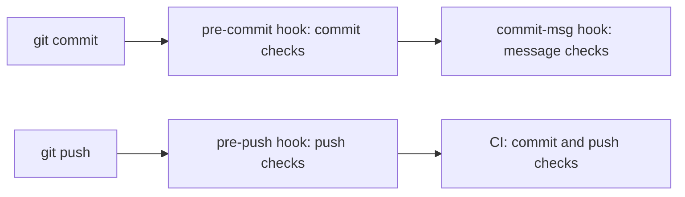

import InlineText from '#docs/components/InlineText.astro';
import { buildLevelRows } from '#docs/reference/levels.ts';

## Configurations

A configuration holds the checks, tool configs, and rules for coding agents of one language, framework, library,
platform, or topic, such as `python` or `nextjs`. `gspot init` selects configurations from your files and dependencies.
gspot selects some configurations in every repository, such as `secrets` and `spelling`. The
[configuration reference](/reference/configurations/) lists them all.

gspot writes the config files of the tools, and the rules in `.gspot/rules/`, from `gspot.toml`. These are the
[generated files](/reference/generated-files/). Your settings live in `gspot.toml`; see
[Change settings](/configure/gspot-toml/).

## Checks and findings

A check runs one tool, such as ESLint, or code built into gspot. Its ID is `<configuration>/<name>`, such as
`python/ruff`. `gspot check --only`, `gspot ignore`, and `gspot explain` take that ID. A
[command check](/configure/command-checks/) runs a command of your own, under the ID you give it.

A finding is one message of a check. Most findings name a file, a line, and a lint rule: one instruction of a linter,
such as `no-console`. Each finding fails its check.

`gspot doctor` reports problems of the setup, such as a missing tool or a hook that does not run. A problem is not a
finding: it has no check ID, and no ignore turns it off.

## Levels

<table>
    <thead>
        <tr>
            <th>Level</th>
            <th>What it checks</th>
            <th>Shipped checks</th>
            <th>Tools it adds</th>
        </tr>
    </thead>
    <tbody>
        {buildLevelRows().map(({ level, description, count, tools }) => (
            <tr>
                <td>
                    <code>{level}</code>
                    {level === 'basic' && ' (default)'}
                </td>
                <td><InlineText text={description} /></td>
                <td>{count}</td>
                <td>{tools}</td>
            </tr>
        ))}
    </tbody>
</table>

The counts cover every shipped configuration. Your repository runs only its selected and applicable checks. Ruff runs
with its preview rules turned on, so a preview rule runs only where a level names it, such as `PLW1514` at level
`basic`.

To change the level, run `gspot set level all`, then `gspot install`. `gspot unset level` returns to `basic`.

## Stages

Each check runs at one stage:

| Stage     | The check runs                           |
| --------- | ---------------------------------------- |
| `commit`  | Before each commit, on the staged files. |
| `push`    | Before each push, on the pushed files.   |
| `message` | On each new commit message.              |
| `manual`  | Only when `gspot check --only` names it. |

Git runs the `commit` checks in the `pre-commit` hook, the `push` checks in the `pre-push` hook, and the `message`
checks in the `commit-msg` hook. No hook runs the `manual` checks. CI and `gspot check` with no `--stage` run the commit
and push checks.

[Git hooks](/use/hooks/) says what each hook checks, and [CI](/use/ci/) what the CI job checks.

## Scopes

A scope is a folder with its own configurations and settings, such as one package of a monorepo. A file belongs to the
deepest scope that holds it. See [Monorepos](/configure/monorepos/).

## Trust

gspot runs code from your repository as your user, with no sandbox. Before you run gspot on a branch that you did not
write, review what it runs:

- Commands in `gspot.toml`: `[[command_check]]` records, `site.build_command`, `openapi.generate_command`, and
  `ci.setup_command`. `site.build_command` defaults to the `build` script of `package.json`.
- Tool configs and plugins that the tools load, such as `prettier.config.mjs`, local ESLint plugins, and Knip plugins.
  Commands such as `astro check`, `svelte-check`, `next typegen`, `drizzle-kit`, and `expo doctor` load project code.
- Tests and builds: Jest, Vitest, pytest with its `conftest.py` files, `swift test`, SwiftPM plugins, and Xcode run
  scripts run your code.
- Tools in `node_modules/.bin`, `.venv/bin`, and the same folders under `.gspot/`.
- Install settings: `.npmrc`, `uv.toml`, `[tool.uv]` in `pyproject.toml`, and the lockfiles in `.gspot/`.
- Git hooks in `.gspot/hooks/`. After `gspot install`, Git runs them on commit, push, and checkout.

gspot lets mise use `.gspot/mise.toml` only when the file matches what gspot wrote and no other mise file sits beside
it. A `mise.local.toml` in `.gspot/` stops mise from running there.
