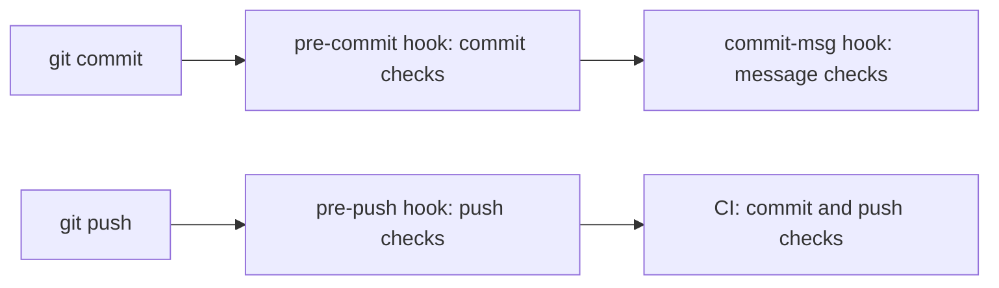

import InlineText from '#docs/components/InlineText.astro';
import { buildLevelRows } from '#docs/reference/levels.ts';

## Configurations

A configuration is the gspot support for one language, framework, library, platform, or topic, such as `python` or
`nextjs`. It holds the checks, the config files of the tools, and the rules for coding agents. `gspot init` turns on
the configurations that match the files and dependencies it finds. Some configurations are on in every repository,
such as `secrets` and `spelling`. The [configuration reference](/reference/configurations/) lists them all.

gspot reads your settings from `gspot.toml`. From those settings, it writes the config file of each tool and the rule
files in `.gspot/rules/`. These are the [generated files](/reference/generated-files/). To change a setting, follow
[Change settings](/configure/gspot-toml/).

## Checks and findings

A check runs one tool, such as ESLint, or code that ships with gspot. Each check has an ID of the form
`<configuration>/<name>`, such as `python/ruff`. `gspot check --only`, `gspot ignore`, and `gspot explain` take that
ID. A [command check](/configure/command-checks/) runs a command that you write, under an ID that you choose.

A finding is one message that a check reports. Most findings name a file, a line, and a lint rule. A lint rule is one
rule of a linter, such as `no-console` in ESLint. A check fails when it reports a finding.

`gspot doctor` reports problems with the setup itself, such as a missing tool or a Git hook that does not run. These
problems are not findings. They have no check ID, and `gspot ignore` cannot turn them off.

## Levels

The level decides how strict the checks are. gspot has two levels:

<table>
    <thead>
        <tr>
            <th>Level</th>
            <th>What it checks</th>
            <th>Shipped checks</th>
            <th>Tools it adds</th>
        </tr>
    </thead>
    <tbody>
        {buildLevelRows().map(({ level, description, count, tools }) => (
            <tr>
                <td>
                    <code>{level}</code>
                    {level === 'basic' && ' (default)'}
                </td>
                <td><InlineText text={description} /></td>
                <td>{count}</td>
                <td>{tools}</td>
            </tr>
        ))}
    </tbody>
</table>

The counts include the checks of every configuration that gspot ships. Your repository runs fewer: only the checks of
the configurations that it uses, and only the checks that apply to it. Ruff runs with its preview rules turned on, but
a Ruff preview rule runs only when a level names it, such as `PLW1514` at level `basic`.

To change the level, run `gspot set level all`, then `gspot install`. To go back to `basic`, run `gspot unset level`.

## Stages

The stage of a check decides when it runs:

| Stage     | The check runs                           |
| --------- | ---------------------------------------- |
| `commit`  | Before each commit, on the staged files. |
| `push`    | Before each push, on the pushed files.   |
| `message` | On each new commit message.              |
| `manual`  | Only when `gspot check --only` names it. |

Git runs the `commit` checks in the `pre-commit` hook, the `push` checks in the `pre-push` hook, and the `message`
checks in the `commit-msg` hook. No hook runs the `manual` checks. CI runs the `commit` and `push` checks, and so does
`gspot check` without `--stage`.

[Git hooks](/use/hooks/) lists what each hook checks, and [CI](/use/ci/) lists what the CI job checks.

## Scopes

A scope is a folder with its own configurations and settings, such as one package of a monorepo. Each file follows the
settings of the deepest scope that contains it. [Monorepos](/configure/monorepos/) shows how to add a scope.

## Trust

gspot runs code from your repository as your user, outside any sandbox. Before you run gspot on a branch that someone
else wrote, review the code that gspot runs:

- Commands in `gspot.toml`: `[[command_check]]` records, `site.build_command`, `openapi.generate_command`, and
  `ci.setup_command`. When `site.build_command` is not set, gspot runs the `build` script of `package.json`.
- Tool configs and plugins that the tools load, such as `prettier.config.mjs`, local ESLint plugins, and Knip plugins.
  Commands such as `astro check`, `svelte-check`, `next typegen`, `drizzle-kit`, and `expo doctor` load project code.
- Tests and builds, which run your code: Jest, Vitest, pytest with its `conftest.py` files, `swift test`, SwiftPM
  plugins, and Xcode run scripts.
- Tools in `node_modules/.bin`, `.venv/bin`, and the same folders under `.gspot/`.
- Install settings: `.npmrc`, `uv.toml`, `[tool.uv]` in `pyproject.toml`, and the lockfiles in `.gspot/`.
- Git hooks in `.gspot/hooks/`. After `gspot install`, Git runs them on commit, push, and checkout.

gspot lets mise use `.gspot/mise.toml` only when the file matches what gspot wrote and no other mise file sits beside
it. A `mise.local.toml` in `.gspot/` stops mise from running there.
