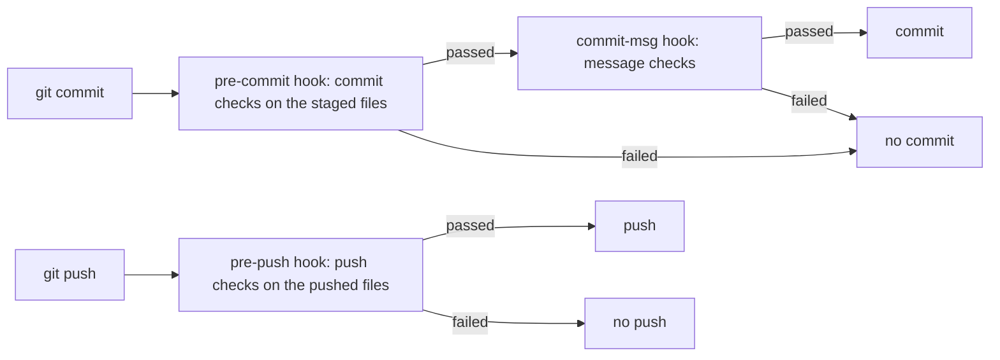

`gspot init` installs these hooks and turns them on, and in a new clone, `gspot install` turns them on. The hooks run
code from your repository, as [Trust](/start/concepts/#trust) describes.

| Hook         | Checks                                                                                                                                          |
| ------------ | ----------------------------------------------------------------------------------------------------------------------------------------------- |
| `pre-commit` | The `commit` checks, on the files as you staged them.                                                                                           |
| `pre-push`   | The `push` checks, on the files that the push changes. At level `all`, `commits/commitlint-pushed` also checks each pushed commit message.      |
| `commit-msg` | The `message` checks, on the new commit message: `commits/references`, and at level `all` also `commits/commitlint` and `prose/commit-message`. |



A commit checks what you stage, and what your staged change breaks in other files, so a commit that touches an old file
fails on that file's old findings. A change to `gspot.toml` does not run the commit checks on other files, so the setup
commit passes once you delete the old tool settings that gspot reports as conflicts.

The pre-push hook checks only the newest commit of each pushed branch. A mistake in an older commit of the push does not
fail the hook when a newer commit fixes it. It does not run the commit checks again, because the pre-commit hook ran
them on each commit, and CI runs both. Checks that read the whole project, such as the type checker, report findings in
files that you did not change. The first push fails until you fix or ignore those old findings, as
[Clean up the first findings](/start/quickstart/#clean-up-the-first-findings) shows.

Hooks in npm, pnpm, and Bun repositories start gspot from `node_modules/.bin`, so they need `node` on the `PATH` that
the Git client gives hooks. Yarn and mise keep their launchers, so those repositories need `yarn` or `mise` on that
`PATH` instead. A Git client can give hooks another `PATH` than your terminal, so a hook can find an older Node.js and
stop on the Node.js minimum. When a hook cannot start gspot, the commit stops, and
[Troubleshooting](/use/troubleshooting/#a-hook-cannot-find-nodejs-yarn-or-mise) shows how to fix it.

## When a hook fails

Fix each finding, then commit or push again. If a finding does not apply to your code, add an ignore with a reason, as
[Ignore findings](/use/ignore/) describes, and stage it with your change.

`git commit --no-verify` skips one hook run. The next run of the check reports the same findings, so it is not a way to
adopt gspot.

## Turn hooks on or off

To turn the hooks on, run:

```shell
gspot set hooks.enabled true
gspot install
```

To turn them off, run `gspot set hooks.enabled false`, and gspot deletes `.gspot/hooks` and unsets the Git setting
`core.hooksPath`. `gspot/weakenings` then fails in CI until you
[give a reason](/configure/gspot-toml/#changes-that-need-a-reason).

## Existing hook managers

If Husky, Lefthook, pre-commit, `simple-git-hooks`, or a hooks folder of your own already runs your Git hooks, gspot
leaves it in charge, and `gspot install` prints what to add. A hook without those lines runs no gspot checks. For a hook
folder or `simple-git-hooks`, add each line to the hook of the same name:

```shell
# pre-commit
.gspot/hooks/pre-commit "$@"
# pre-push
.gspot/hooks/pre-push "$@"
# commit-msg
.gspot/hooks/commit-msg "$@"
```

Lefthook passes no push input to a command without `use_stdin`, so add this to `lefthook.yml`:

```yaml
pre-commit:
  commands:
    gspot:
      run: .gspot/hooks/pre-commit
pre-push:
  commands:
    gspot:
      run: .gspot/hooks/pre-push {0}
      use_stdin: true
commit-msg:
  commands:
    gspot:
      run: .gspot/hooks/commit-msg {1}
```

pre-commit passes no push input to any hook, so the push checks run from `.git/hooks/pre-push`. Add this to the `repos`
of `.pre-commit-config.yaml`:

```yaml
- repo: local
  hooks:
    - id: gspot-pre-commit
      name: gspot pre-commit
      entry: .gspot/hooks/pre-commit
      language: system
      always_run: true
      pass_filenames: false
      stages: [pre-commit]
    - id: gspot-commit-msg
      name: gspot commit-msg
      entry: .gspot/hooks/commit-msg
      language: system
      always_run: true
      stages: [commit-msg]
```

Then run these commands in each clone, because `.git/hooks` is not tracked:

```shell
pre-commit install --hook-type pre-commit --hook-type commit-msg
printf '#!/bin/sh\n.gspot/hooks/pre-push "$@"\n' > .git/hooks/pre-push
chmod +x .git/hooks/pre-push
```

## Test a hook

To run the checks of the pre-commit and commit-msg hooks without committing:

```shell
gspot check --staged --only commit
gspot check --hook commit-msg -- .git/COMMIT_EDITMSG
```

The pre-push hook reads the remote and the list of pushed commits from Git, so test it with a real `git push`. After a
failed push, the `rerun:` line of the report is `gspot check --only <check> --base <hash>`, where `<hash>` is the commit
that the remote had. To see the result without pushing, run `gspot check --base origin/HEAD`.

## Large files

When a tracked file has the Git attribute `filter=lfs`, gspot writes the `pre-push`, `post-checkout`, `post-commit`, and
`post-merge` hooks that Git Large File Storage (LFS) needs, so LFS needs no other hook manager. A `filter=lfs` pattern
that matches no tracked file adds none of them. The `pre-push` hook runs the gspot checks before `git lfs pre-push`, so
a push that the checks stop uploads no LFS file. If `git-lfs` is not on `PATH`, the hook exits with code 2 before any
check runs, and asks you to install it.
